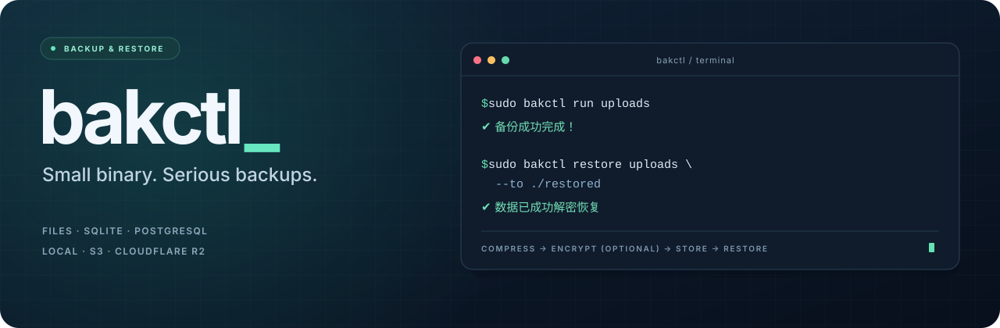

<div align="center">
  

  <p><strong>给服务器的数据，留一份可恢复的备份。</strong></p>
  <p>文件 · 目录 · SQLite · PostgreSQL<br />gzip 压缩 · 可选 AES-256-GCM 加密 · 本地 / S3 存储 · systemd 定时</p>

  <p>
    <a href="https://github.com/9star-academy/bakctl/releases/tag/v1.1.0-rc.2"></a>
    <a href="https://github.com/9star-academy/bakctl/actions/workflows/ci.yml"></a>
    <a href="go.mod"></a>
    <a href="#install"></a>
    <a href="LICENSE"></a>
  </p>

  <p>
    <a href="#features">备份能力</a> ·
    <a href="#install">安装</a> ·
    <a href="#quick-start">快速开始</a> ·
    <a href="#cloud-storage">云存储</a> ·
    <a href="#databases">数据库</a> ·
    <a href="#operations">配置与排查</a> ·
    <a href="#restore">恢复验收</a>
  </p>
</div>

> [!IMPORTANT]
> 当前验收版本为 **[v1.1.0-rc.2](https://github.com/9star-academy/bakctl/releases/tag/v1.1.0-rc.2)**，属于预发布版。请按下方命令固定版本安装，并完成恢复演练后再用于正式数据。查看 [发布说明](docs/releases/v1.1.0-rc.2.md) · [验收指南](docs/testing.md)。

<a id="features"></a>

## 备份能力

| 能力 | 说明 |
| --- | --- |
| 文件与目录 | 恢复原文件内容或完整目录结构；支持归档内的相对符号链接，拒绝指向归档外的链接及特殊设备文件 |
| SQLite | 调用 `sqlite3` 在线 `.backup`，包含已提交的 WAL 数据；缺少工具或热备失败时明确失败，不复制运行中的主库降级 |
| PostgreSQL | 调用 `pg_dump` 输出 SQL；恢复命令下载并还原 SQL 文件，导入数据库需另行执行 `psql` |
| 存储 | 本地目录、AWS S3、Cloudflare R2 及兼容 S3 SigV4 的服务；其他厂商需自行验证兼容性 |
| 加密 | 新备份使用带随机盐的 PBKDF2-SHA256 与分块 AES-256-GCM；校验错误密码、篡改和截断 |
| 保留策略 | `--keep N` 按任务保留最新 N 份；`0` 表示不自动删除；清理失败会返回非零 |
| 调度 | Linux systemd，支持 `day@03:00`、`daily`、`6h`、`30m`、`7d` 等；macOS 可手动备份和恢复 |

<details>
<summary><strong>运行依赖与支持边界</strong></summary>

**尚未实现：MySQL/MariaDB、WebDAV、zstd、按天/周保留、Telegram/飞书/企业微信/Bark/Webhook 通知。** `--webhook` 不会静默接受无效配置。Go 程序没有第三方模块依赖，但数据库备份需要上述命令行工具，定时执行需要 Linux systemd。

若旧配置包含 `webhook_url`，需移除该字段后运行；当前版本会明确报错，不会报告并未发送的通知已成功。

</details>

<a id="install"></a>

## 安装

支持 Linux / macOS 的 `amd64` 与 `arm64`。需要 `curl`，以及 `sha256sum` 或 macOS 的 `shasum`：

```bash
curl -fsSL https://raw.githubusercontent.com/9star-academy/bakctl/v1.1.0-rc.2/scripts/install.sh -o /tmp/bakctl-install.sh
sudo env BAKCTL_VERSION=v1.1.0-rc.2 bash /tmp/bakctl-install.sh
bakctl --version
```

预期输出：

```text
bakctl version v1.1.0-rc.2
```

安装脚本会校验 Release 的 `SHA256SUMS`，再原子替换程序；网络或校验失败会保留已安装版本。不指定 `BAKCTL_VERSION` 时仅查询最新正式 Release，不会选择 RC。缺少校验和的旧 Release 会明确安装失败。

<details>
<summary><strong>更多安装方式：个人目录 / 源码构建</strong></summary>

安装到个人目录：

```bash
BAKCTL_VERSION=v1.1.0-rc.2 BAKCTL_INSTALL_DIR="$HOME/.local/bin" bash /tmp/bakctl-install.sh
```

请将 `$HOME/.local/bin` 加入 `PATH`；也可通过 `BAKCTL_VERSION=vX.Y.Z` 固定其他已发布版本。

**安装脚本不会获得尚未发布的源码改动。** 也可使用 Go 1.24 或更新版本从源码构建：

```bash
git clone https://github.com/9star-academy/bakctl.git
cd bakctl
go test ./...
go build -o bakctl ./cmd/bakctl
sudo install -m 0755 bakctl /usr/local/bin/bakctl
```

</details>

<a id="quick-start"></a>

## 快速开始

以 Linux 服务器上的 `/var/www/uploads` 为例。系统级任务统一使用 `sudo`，避免混用普通用户和 root 的配置；macOS 手动使用时省略 `--every`。

### 1. 添加存储目标

目标目录须位于备份源之外。使用独立磁盘或远端存储，才能覆盖本机磁盘故障场景。

```bash
sudo bakctl target add local-disk --type local --path /var/backups/bakctl
```

### 2. 创建备份任务

每天 **03:00** 执行，保留最新 **14 份**，并启用加密。不传 `--every` 即为手动任务。

```bash
sudo bakctl add uploads \
  --src /var/www/uploads \
  --to local-disk:uploads \
  --every 'day@03:00' \
  --keep 14 \
  --encrypt-key '<请替换为高强度备份密码>'
```

### 3. 备份，并验证恢复

```bash
# 立即运行并查看结果
sudo bakctl run uploads
sudo bakctl list

# 恢复到一个尚不存在的新目录，避免覆盖线上文件
sudo bakctl restore uploads --to /var/tmp/uploads-restored

# 比较内容；数据未变化时应无差异输出，再确认权限、符号链接和业务可读性
sudo diff -r /var/www/uploads /var/tmp/uploads-restored
```

> [!TIP]
> 恢复目标必须是**尚不存在的路径**，包括空目录或符号链接都不能作为目标。单文件任务传文件路径，目录任务传目录路径；`--dest` 是 `--to` 的兼容别名。

恢复时先在私有临时位置完成解密、校验和解包，再发布结果；出错不会用半份内容覆盖原数据。

<a id="cloud-storage"></a>

## 云存储

本地存储之外，也可以写入 AWS S3 或 Cloudflare R2。以下示例需替换占位值；其他 S3 兼容服务请先验证兼容性。

<details>
<summary><strong>Cloudflare R2</strong> · 配置目标 my-r2</summary>

```bash
sudo bakctl target add my-r2 \
  --type s3 \
  --endpoint 'https://<account-id>.r2.cloudflarestorage.com' \
  --bucket backups \
  --access-key '<access-key-id>' \
  --secret-key '<secret-access-key>' \
  --region auto
```

</details>

<details>
<summary><strong>AWS S3</strong> · 配置目标 my-s3</summary>

指定 bucket 所在区域的 endpoint 和 region：

```bash
sudo bakctl target add my-s3 \
  --type s3 \
  --endpoint 'https://s3.ap-southeast-1.amazonaws.com' \
  --bucket '<bucket-name>' \
  --access-key '<access-key-id>' \
  --secret-key '<secret-access-key>' \
  --region ap-southeast-1
```

</details>

目标存储需允许相应对象前缀的上传、下载、列举和删除操作；使用 `--keep 0` 时不会清理对象。列表支持分页，恢复和清理仅选择当前任务的完整备份文件名，`app` 不会匹配 `app_db`。

<a id="databases"></a>

## 数据库备份

安装适合服务器的数据库客户端。例如 Debian/Ubuntu：

```bash
sudo apt-get install sqlite3 postgresql-client
```

PostgreSQL 的 `pg_dump` 主版本应与服务端兼容。数据库连接权限和认证由数据库工具处理。示例使用上方已配置的 `my-r2`，也可替换为 `local-disk`。

<details>
<summary><strong>SQLite</strong> · 在线备份、恢复与完整性检查</summary>

使用 `sqlite3 .backup` 获取包含已提交 WAL 数据的在线备份。恢复后，`integrity_check` 预期输出 `ok`：

```bash
sudo bakctl add app-db \
  --src sqlite:///var/lib/myapp/data.db \
  --to my-r2:sqlite \
  --every '6h' --keep 14 \
  --encrypt-key '<备份密码>'
sudo bakctl run app-db
sudo bakctl restore app-db --to /var/tmp/app-restored.db
sudo sqlite3 /var/tmp/app-restored.db 'PRAGMA integrity_check;'
```

</details>

<details>
<summary><strong>PostgreSQL</strong> · SQL 导出与隔离数据库验收</summary>

`bakctl restore` 会还原 SQL 文件；导入数据库需要另行执行 `psql`。

```bash
sudo bakctl add pg-db \
  --src 'postgres://backup@127.0.0.1:5432/app' \
  --to my-r2:postgres --every 'day@03:00' --keep 14
sudo bakctl run pg-db
sudo bakctl restore pg-db --to /var/tmp/app-restored.sql

# 在专门的测试数据库验收；bakctl 不会自动导入或覆盖生产数据库
sudo cat /var/tmp/app-restored.sql | psql --dbname=restore_test --set=ON_ERROR_STOP=1
```

`pg://` 是 `postgres://` 的兼容别名，也支持 `postgresql://`。建议使用受保护的 `.pgpass` 或 PostgreSQL 自身认证配置，避免将数据库密码放到命令行。

</details>

系统 timer 使用系统服务的用户与环境，需保证该环境也能访问客户端和凭据。

<a id="operations"></a>

## 配置与排查

### 配置位置

| 运行方式 | 配置文件 |
| --- | --- |
| root / `sudo` | `/etc/bakctl/config.json` |
| 普通用户 | `~/.config/bakctl/config.json` |
| 自定义 | `BAKCTL_CONFIG=/absolute/path/config.json` |

自定义配置的 systemd unit 会记录绝对路径，避免定时运行时读错配置。配置文件以 `0600` 写入，包含存储凭据和备份密码，必须保护该文件及其父目录。命令行密码也可能进入 shell 历史，请另外离线保管解密密码。

### 定时任务

| 调度示例 | 执行时间 |
| --- | --- |
| `day@03:00` | 每天 03:00，使用服务器本地时区 |
| `daily` / `day` | 同每天 03:00 |
| `30m` / `6h` / `7d` | 启用约 5 分钟后首次运行，之后按指定间隔执行 |

间隔形式支持正整数 `s/m/h/d`；首次触发使用 `OnActiveSec=5m`，其后以上次服务启动时间为基准计算。systemd 精度设置可能带来小幅延迟，任意原始 `OnCalendar` 表达式目前不支持。

查看下一次执行时间和运行日志：

```bash
systemctl list-timers 'bakctl-*'
systemctl status bakctl-uploads.timer
journalctl -u bakctl-uploads.service --since today
```

配置写入、上传、保留清理或定时器安装失败都会返回非零退出码。定时器安装失败时，任务配置仍保留便于排查；修复权限或 systemd 环境后，删除该任务再重新添加。不要只看“配置已保存”就认为 timer 已启用，应确认 `systemctl list-timers` 中的下一次执行时间。

<details>
<summary><strong>任务管理与并发规则</strong></summary>

```bash
sudo bakctl list          # 查看任务
sudo bakctl target list   # 查看存储目标
sudo bakctl rm uploads    # 删除任务；已存储的备份会保留
```

任务和目标名称需为 1–128 位字母、数字、点、下划线或连字符，并以字母或数字开头。同名 target 和 job 会被拒绝，避免意外替换备份位置或密钥。删除任务不会删除已经存储的备份；重新配置时保留原目标、任务名、前缀和密码，才能继续发现并恢复原备份。仍被任务引用的 target 不能删除。

配置修改使用进程锁、重新加载与原子写入。相同配置中的同一任务不能同时备份、恢复或删除；手动命令冲突时会报错，不同任务可以并行。systemd 以 `run <任务名> --wait` 等待任务锁，避免启用 timer 或持久化补跑时与配置操作冲突；手动运行也可使用此参数。不要让多个独立主机/配置同时写同一个存储前缀和任务名。

systemd unit 名称为 `bakctl-<任务名>.service/.timer`，在系统范围共享；不同自定义配置不能接管同名 unit。

</details>

<a id="restore"></a>

## 恢复与验收

当前备份包含格式版本和源类型，新版能够明确区分单文件、目录和数据库输出，并能读取 v1 的 gzip/AES-GCM 备份。**旧版程序无法读取新格式**，升级后请保留新版二进制用于恢复。

<details>
<summary><strong>恢复 v1 旧版备份</strong> · 显式指定源类型</summary>

v1 tar 没有类型信息。原始路径还存在时，任务配置可提供类型提示；灾难恢复时原路径已丢失且无法确定类型，必须显式指定，程序不会猜测：

```bash
sudo bakctl restore old-file --to /var/tmp/file-restored --legacy-type file
sudo bakctl restore old-directory --to /var/tmp/dir-restored --legacy-type directory
sudo bakctl restore old-db --to /var/tmp/db-restored --legacy-type raw
```

</details>

### 空间与数据一致性

新格式的备份、压缩、加解密和上传采用流式处理及私有临时文件，避免把整个数据集装入内存；临时磁盘必须有足够空间容纳数据和中间产物。读取 v1 整块加密文件仍需要与该旧文件大小相当的内存。

普通目录不是文件系统快照：对持续变化的数据，工具会检测部分文件变化并报错，但不能保证多文件业务事务的一致性。数据库应使用对应的在线备份方式；需要目录级一致性时先暂停写入或使用文件系统快照。不要把本地备份目标或 `TMPDIR` 放进备份源内；例如备份 `/tmp` 时需要指定源目录之外的临时目录。绝对、循环或越出目录边界的符号链接会被拒绝。旧配置中的相对源路径需重新配置为绝对路径。

### 上线前的恢复演练

| 备份类型 | 验收重点 |
| --- | --- |
| 文件 | 内容一致、业务程序可读取 |
| 目录 | 结构、权限与相对符号链接符合预期 |
| SQLite | `integrity_check` 返回 `ok`，关键业务行数一致 |
| PostgreSQL | SQL 导入隔离数据库成功，关键数据查询正常 |

**仅看到上传成功不能代替恢复验收。** 完整部署检查清单见 [验收指南](docs/testing.md)。

<a id="development"></a>

## 开发与验证

```bash
go test -race -coverprofile=coverage.out ./...
go vet ./...
go tool cover -func=coverage.out
bash -n scripts/install.sh
```

测试涵盖文件/目录往返、SQLite WAL、旧格式兼容、错误密码与损坏/截断拒绝、路径穿越、任务隔离、同秒重复执行、配置并发、S3 官方签名向量和分页、systemd 失败传播及安装校验失败。SQLite 集成测试在缺少 `sqlite3` 时跳过，CI 会安装并检查该工具。

S3 测试使用隔离的 HTTP transport，systemd 测试使用临时目录与替代执行器。这些测试不代表已在你的云账号或实际 Linux 服务管理器上通过验收，部署时还应完成真实上传、下载、清理和 timer 触发检查。

本次修复的验证记录和部署验收步骤见 [docs/testing.md](docs/testing.md)。

## License

本项目采用 [MIT License](LICENSE)。

---

<div align="center">
  <a href="https://github.com/9star-academy/bakctl/releases">下载版本</a> ·
  <a href="docs/testing.md">验收指南</a> ·
  <a href="https://github.com/9star-academy/bakctl/issues">反馈问题</a> ·
  <a href="#development">参与开发</a>
</div>
